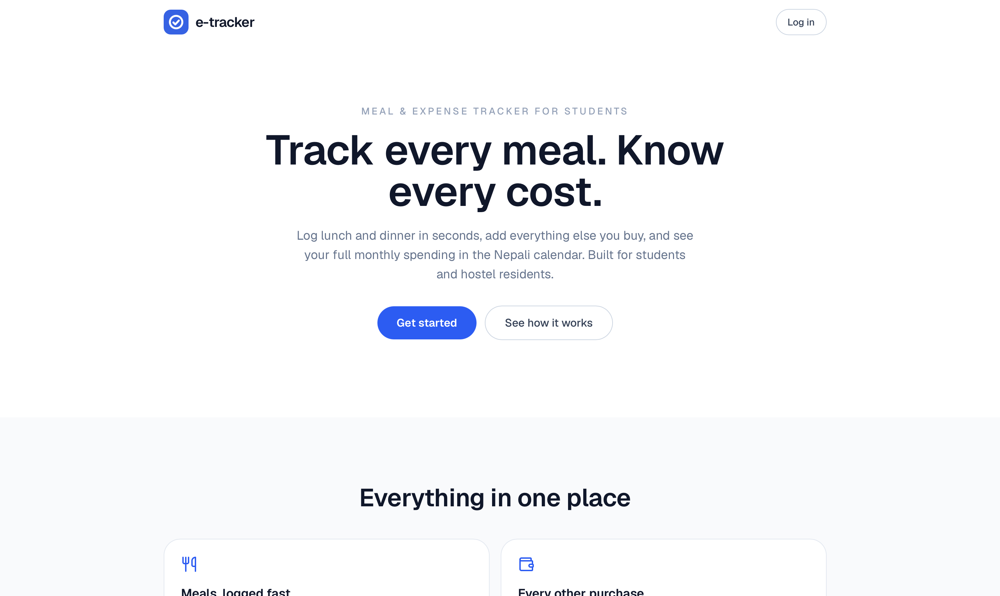

# eatracker

**Track every meal. Know every cost.**

A meal and expense tracker built for students and hostel residents in Nepal. Log lunch and dinner in seconds, keep other purchases separate, and see exactly what you spent each month in the Bikram Sambat (Nepali) calendar.

**Live app:** [eatracker.vercel.app](https://eatracker.vercel.app) · [rkundan.com.np](https://rkundan.com.np)

<!-- Screenshot: save it as docs/screenshot.png, then uncomment the line below.

-->

## Why this exists

Hostel life means eating the same few meals every day and losing track of what it all adds up to. eatracker costs each meal automatically from prices you set once, so a month of food spending is a number you can see, not a guess.

## Features

- **Quick meal logging.** Pick lunch and dinner items; each entry is costed automatically from your saved prices (meals, eggs, curd, chicken and more).
- **Separate expense tracking.** Record non-food purchases (clothes, equipment) with a description and price. Monthly totals can be viewed with or without food.
- **Nepali calendar.** Dates and monthly totals follow Bikram Sambat months, with English dates shown alongside.
- **Streaks, badges and points.** Logging a meal on the day it happened builds a streak and earns points. Points can be converted into automatic meal entries. Back-dated entries earn no points.
- **Leaderboard.** Rankings show first name, last initial and points only. Spending is never shown.
- **Daily auto-entry.** A scheduled job creates automatic meal entries for users who redeemed points.
- **Accounts and email.** Sign-up, sign-in and password reset, with email sent through Resend. Open to anyone aged 16 or over.
- **Feedback form.** Users can send feedback from the Account page.
- **Admin area.** Restricted to emails listed in an environment variable.

## Tech stack

| Area | Technology |
|---|---|
| Framework | [Next.js](https://nextjs.org) 16 (App Router), React 19, TypeScript |
| Styling | Tailwind CSS 4, [Lucide](https://lucide.dev) icons |
| Database | PostgreSQL ([Neon](https://neon.tech)) |
| ORM | [Prisma 8](https://www.prisma.io) (contract in `src/prisma/contract.prisma`) |
| Sessions | Signed tokens with [jose](https://github.com/panva/jose) |
| Email | [Resend](https://resend.com) |
| Calendar | [nepali-date-converter](https://www.npmjs.com/package/nepali-date-converter) |
| Hosting | [Vercel](https://vercel.com) with Vercel Cron and Analytics |

## Getting started

### Prerequisites

- Node.js 20.9 or newer
- An empty PostgreSQL database (a free [Neon](https://neon.tech) project works well)
- A [Resend](https://resend.com) API key (only needed to send email)

### Run locally

```bash
git clone https://github.com/ramkundan1/hostel-food-tracker.git
cd hostel-food-tracker
npm install
cp .env.example .env      # then fill in your values
```

Apply the database contract to your empty database, then start the dev server:

```bash
npx prisma db init --db "<your DATABASE_URL>"
npm run dev
```

Open [http://localhost:3000](http://localhost:3000). When you change `src/prisma/contract.prisma`, run `npm run contract:emit` and then `npx prisma db update --db "<your DATABASE_URL>"`.

## Environment variables

Copy `.env.example` to `.env` for local development. In production, set these in your Vercel project settings. **Never commit `.env`.**

| Variable | Required | Purpose |
|---|---|---|
| `DATABASE_URL` | Yes | PostgreSQL connection string |
| `AUTH_SECRET` | Yes | Secret used to sign sessions. Generate with `openssl rand -base64 32` |
| `APP_URL` | Yes | Public base URL (e.g. `http://localhost:3000` locally) |
| `RESEND_API_KEY` | For email | API key for sending email |
| `EMAIL_FROM` | For email | Sender address for outgoing email |
| `SUPPORT_EMAIL` | For feedback form | Where Account-page feedback is delivered |
| `CRON_SECRET` | Production | Protects the daily auto-entry cron endpoint |
| `ADMIN_EMAILS` | Optional | Emails allowed to use the admin area |
| `GOOGLE_SITE_VERIFICATION` | Optional | Google Search Console verification token |

## Project structure

```
src/
  app/          Pages and API routes (App Router)
  components/   Shared UI components
  lib/          Auth, email, pricing, stats, rate limiting and helpers
  prisma/       Database contract
migrations/     Prisma migration history
vercel.json     Cron schedule for the daily auto-entry job
```

## Deployment

Deployed on Vercel.

1. Import the repository into Vercel.
2. Add the environment variables above under **Project Settings → Environment Variables**.
3. Deploy. The cron schedule lives in `vercel.json`.

## Security

- Secrets live only in environment variables; none are stored in the repository.
- Admin access is granted only through `ADMIN_EMAILS`.
- The cron endpoint requires `CRON_SECRET`.

Found a vulnerability? Please open a private security advisory on GitHub instead of a public issue.

## Contributing

Issues and suggestions are welcome. For anything larger than a small fix, please open an issue first.

## Author

Built by [@ramkundan1](https://github.com/ramkundan1), a computer engineering student at Purwanchal Campus (IOE, Tribhuvan University), Nepal.

Website: [rkundan.com.np](https://rkundan.com.np)

## License

No license has been chosen yet, so all rights are reserved for now.
